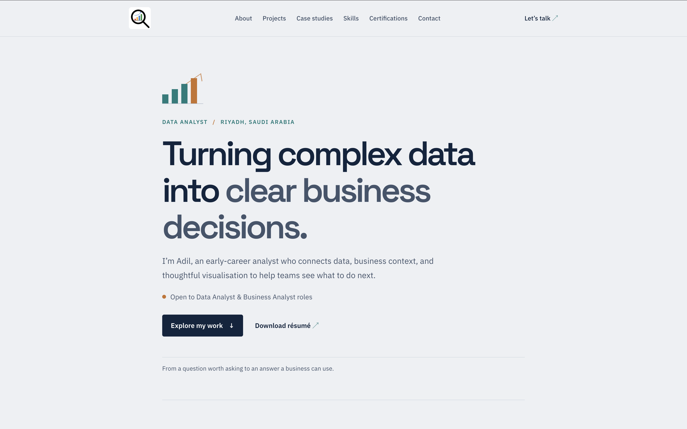

# Adil Muhammed K M | Data Analytics Portfolio

An early-career Data Analyst and Business Analyst focused on transforming complex data into clear business decisions through analysis, visualization, and business insights.

## Live Portfolio

**[Visit My Portfolio](https://adilmuhammedkm.github.io/Portfolio-Website/)**



*Explore my data analytics projects, case studies, technical skills, certifications, and professional background.*

## What's Inside

- Data analytics and business intelligence projects
- Project case studies and analytical insights
- Technical skills and tools
- Professional certifications and education
- Résumé and contact information

## Technologies

- HTML5
- CSS3
- JavaScript
- Git and GitHub
- GitHub Pages

## Run Locally

Clone the repository:

```bash
git clone https://github.com/adilmuhammedkm/Portfolio-Website.git
cd Portfolio-Website
```

Open `index.html` in your browser to view the website locally.

## Connect

- **Portfolio:** https://adilmuhammedkm.github.io/Portfolio-Website/
- **LinkedIn:** https://www.linkedin.com/in/adilkm/

---

*Thank you for visiting my portfolio!*

